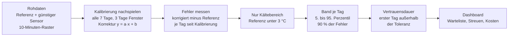
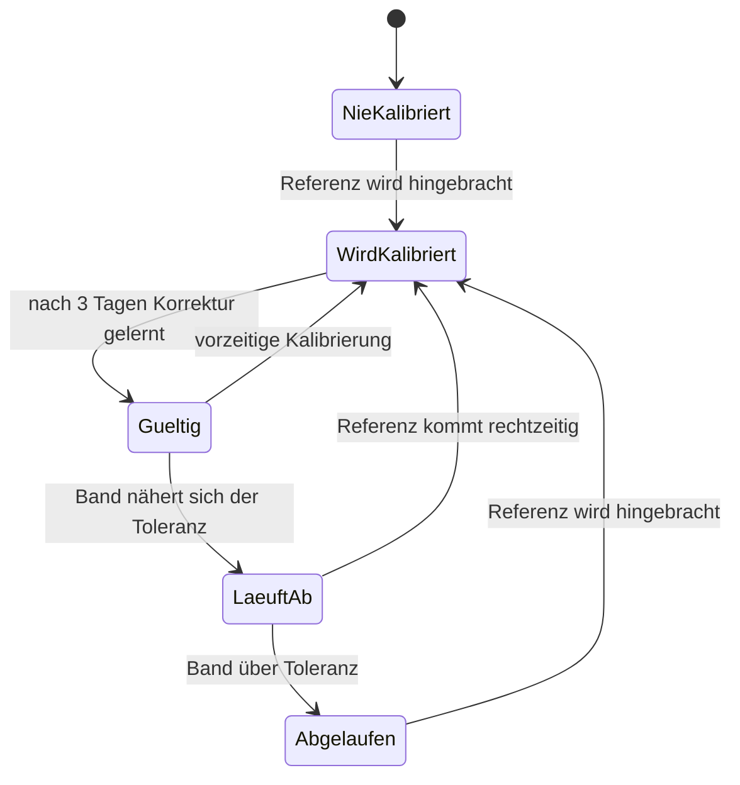

# TrustBand

*Wann kann ich einem günstigen Oberflächentemperatursensor noch trauen, und wohin schicke ich als Nächstes den teuren Referenzsensor?*

Prototyp für den Smart City Hackathon Pforzheim 2026, Challenge "Präziser Winterdienst".

## Idee

1. Ein günstiger Sensor (Decentlab DL-ITST) bekommt 1–3 Tage einen teuren Referenzsensor (DL-CWS) daneben.
2. Daraus wird pro Sensor eine einfache Korrektur gelernt (y = a·x + b).
3. Die Restunsicherheit wird als **Band** angegeben, das mit dem Eichalter wächst. Solange das Band innerhalb der Toleranz bleibt, gilt der Sensor als vertrauenswürdig.
4. Danach wandert der Referenzsensor zum nächsten Standort. Das Dashboard schlägt vor, wohin.

## Methode

Das Vertrauensband wird per **Rückrechnung (Backtest)** aus echten Paardaten von Referenz und günstigem Sensor gelernt. Wir simulieren dazu, wie es gewesen wäre, wenn man jede Woche kalibriert hätte, und messen danach, wie weit der günstige Sensor von der Referenz abweicht.



## Lebenszyklus eines Sensors



Das Band startet als Pilotprofil der beiden vermessenen Standorte (Arlinger, Schellbronner). Jeder Referenzbesuch liefert eine Driftmessung für den jeweiligen Standort und macht das Band genauer.

## Dashboard ansehen

Statische Seite, kein Build nötig:

```bash
python -m http.server 8765 --directory docs
```

Dann `http://localhost:8765` öffnen. Auf GitHub Pages: Einstellungen → Pages → Ordner `/docs`.

## Aufbau

```
trustband/
├── analysis/
│   ├── analyze.py                  Analyse der Rohdaten (Rohdaten nicht im Repo)
│   ├── daily_bands.py              Band je Tag seit der Eichung -> bands_daily.json
│   ├── results.json                Fehler und 90-%-Band je Eichalter
│   └── bands_daily.json            Band pro Tag (Trichter)
├── scripts/
│   └── build_dashboard_data.py     results.json + Standortliste -> docs/data/dashboard.js
└── docs/                           Dashboard, direkt über GitHub Pages ausspielbar
    ├── index.html
    ├── style.css
    ├── app.js
    └── data/dashboard.js
```

Daten neu bauen: `python scripts/build_dashboard_data.py --api-md <Standortliste.md>`.
Analyse neu rechnen: `TRUSTBAND_DATA=<Datenordner> python analysis/analyze.py` (braucht pandas, numpy, matplotlib).

## Grenzen

- Ein Modell von Standort A hilft an Standort B nicht. Jeder Sensor braucht seine eigene Eichung.
- Der Referenzsensor hat selbst ±0,5 °C.
- Wirtschaftlich nur, wenn das Vertrauen lange genug hält. Das Dashboard rechnet den Break-even aus.

## Datenschutz

Verarbeitet werden nur Temperaturmessungen und Sensorstandorte, keine personenbezogenen Daten.

Kartendaten © OpenStreetMap-Mitwirkende.
